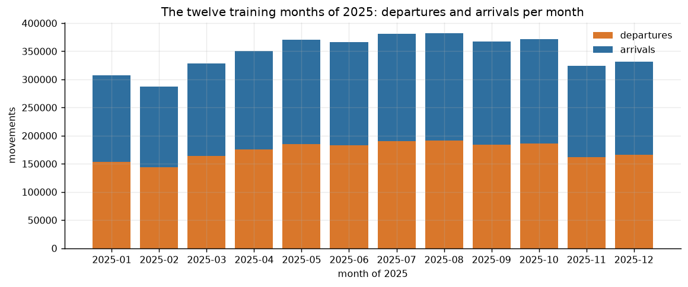
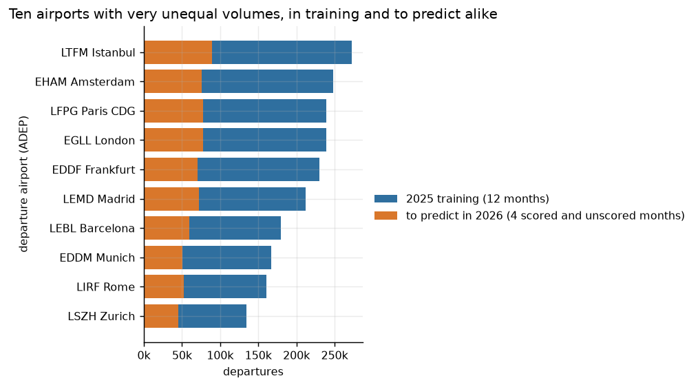
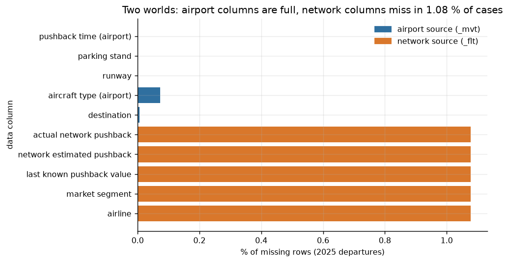
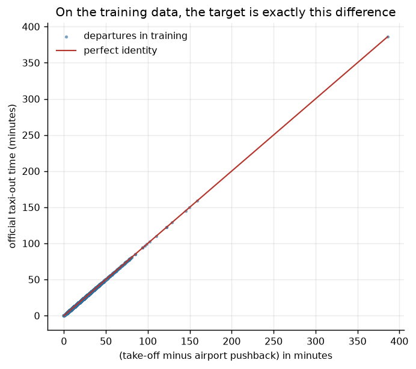
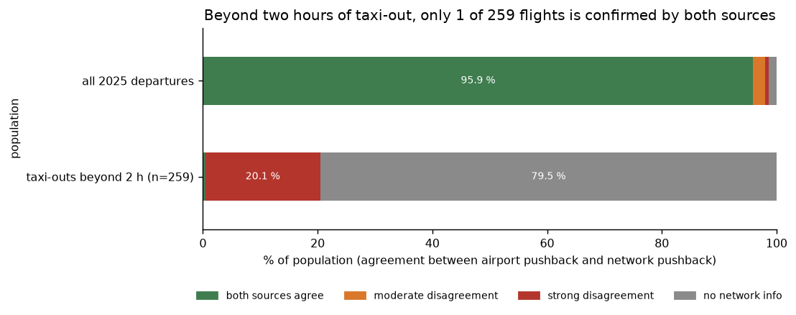
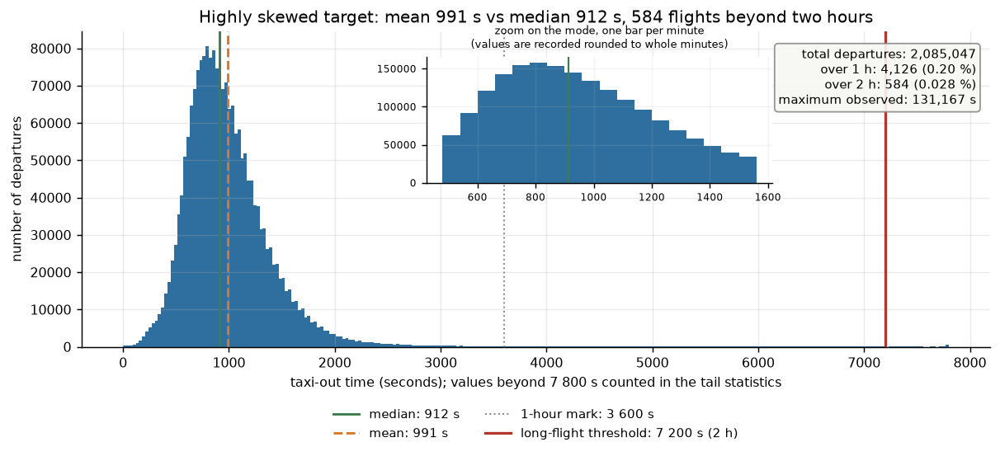
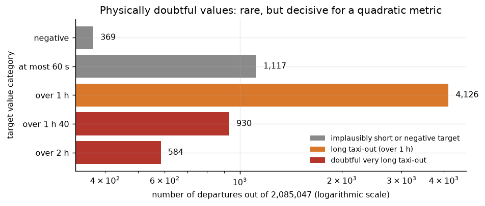
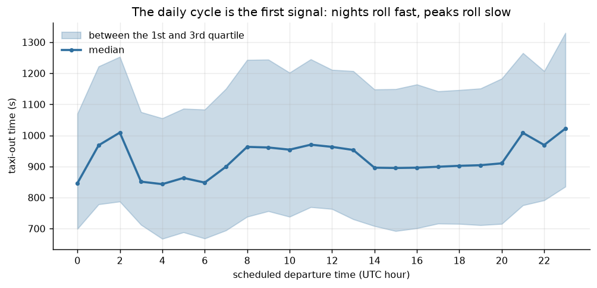
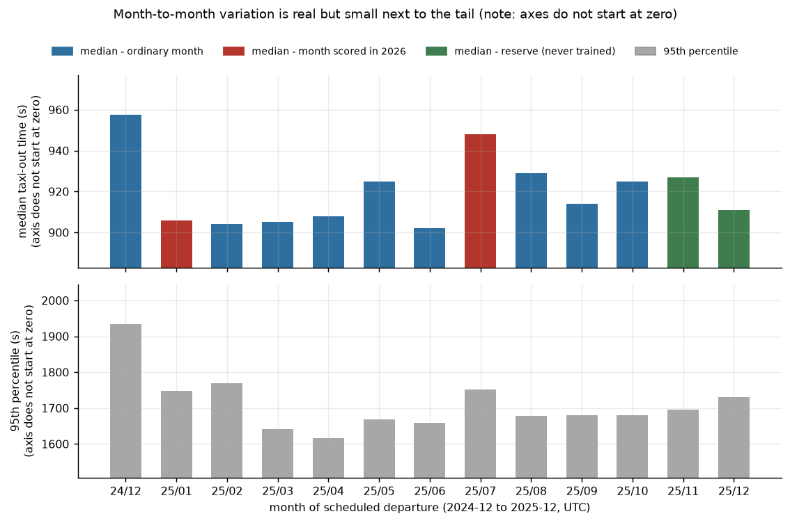

# Data Dictionary (verified on the files, not just the documentation)

## Files in the official folder and actual role

| file | rows | verified roles |
| --- | ---: | --- |
| `training_2025-MM-01_*.parquet` ×12 | 4 167 797 total | training + validation; target present, never null |
| `ranking.parquet` | 689 534 | previous phase: January + July 2026 (both months **scored**), departure targets masked, **arrivals labelled** at 100 %; identifiers ⊂ `final_ranking` (689 534 out of 689 534) |
| `submitting.parquet` | 344 841 | template for the previous phase (= departures from `ranking.parquet`) |
| `final_ranking.parquet` | 1 341 197 | **official final entries**: Jan 305 590, Feb 288 432, Jun 363 231, Jul 383 944 movements; unlabelled departures, **670 407 arrivals with actual taxi time** across the ten platforms |
| `final_submitting.parquet` | 670 790 | **final template**: exactly the departures from `final_ranking.parquet` |

> Ranking scope (home page, re-checked on 2026‑10‑10): "The applied ranking will use RMSE for
> submitted predictions for the movements in **January and July 2026**". The template covers four months,
> the score grades two (`RULES.md`).

Extreme dates for 2025: `2025-01-01 00:01:04` → `2025-12-31 23:57:36`. No duplicates on
`MVT_ID_mvt` (4 167 797 unique identifiers for 4 167 797 rows).

*Figure — movements per month.*

*Figure — departures per hub airport.*

**Final template types** (verified on the file, correcting an earlier erroneous reading):
`MVT_ID_mvt` is **float64** and `TAXITIME_SEC_mvt` is **float64**, with `NaN` values awaiting completion —
whereas the target is `int32` in the training files. `src.predict.py` therefore enforces no fixed type:
it reuses the dtype of the template column, which `src.validate_submission.py` checks (a dtype
divergence is reported as a warning).

## Schema (30 columns) and eligibility status per track

Suffix `_mvt` = declaring airport, `_flt` = Network Manager flight list.

| column | type | null rate, 2026 departures | causal use | reconstruction use |
| --- | --- | ---: | --- | --- |
| `MVT_ID_mvt` | double | 0,000 % | identifier (max 2,14×10⁸ ≪ 2⁵³ → exact in floating point) | same |
| `PHASE_mvt` | string | 0,000 % | population filter | same |
| `ADEP_mvt` / `ADES_mvt` | string | 0,000 % | airport (departure) / destination | same |
| `SCHED_TIME_UTC_mvt` | timestamp | 0,000 % | **calendar base and planned congestion** | same |
| `AIRCRAFT_TYPE_mvt` | string | 0,093 % | aircraft variable | same |
| `AIRCRAFT_TYPE_flt`, `WK_TBL_CAT_flt` | string | 1,353 % / 1,357 % | aircraft variables (network) | same |
| `MARKET_SEGMENT_flt`, `FLIGHT_RULE_*`, `FLIGHT_TYPE_flt` | string | ≤ 1,357 % | operational variables | same |
| `AIRCRAFT_OPERATOR_flt` | string (anonymised) | 1,353 % | smoothed target encoding | same |
| `STAND_mvt` | string | 0,001 % | parking stand position (135–380 per airport) | same |
| `RUNWAY_mvt` | string | 0,000 % | **excluded** (runway actually used) | included |
| `EOBT_1_flt`, `IOBT_flt`, `LOBT_flt` | timestamp | 1,353 % | planned delays (see evidence below) | same |
| `MVT_TIME_UTC_mvt` | timestamp | 0,000 % | **forbidden** (take-off) | proxy |
| `AOBT_3_flt` | timestamp | 1,353 % | **forbidden** (actual M3 off‑block) | estimate of `BLOCK_TIME` |
| `BLOCK_TIME_UTC_mvt` | timestamp | **100 % null** | unavailable | masked by the organizer |
| `TAXITIME_SEC_mvt` | int32 | **100 % null** | target | target |
| `ADES_FILED_flt`, `CALLSIGN_flt`, `FLIGHT_ID_mvt`, `FLIGHT_mvt`, `ARVT_1_flt`, `ARVT_3_flt` | — | — | not used (identifiers, subsequent arrival times) | same |

**The `_flt` gaps are not poorly filled columns.** Each network column is empty for 1,353 % (2026)
and 1,338 % (2025 development) of rows — and these are **the same rows**: across this 1,35 % of
departures, all eleven `_flt` columns are missing at once (flight not registered by the network). This is
a property of the row, not uneven field quality; `T0_DISPONIBILITE.md` draws the consequences, and
`PYTHONPATH=. .venv/bin/python scripts/null_rates.py` reproduces these percentages.

*Figure — missing values: entire rows are missing the `_flt` columns at once.*

## Evidence measured on 2025 (departures, 2 085 047 rows)

- Official identity verified: `TAXITIME_SEC_mvt == MVT_TIME_UTC_mvt − BLOCK_TIME_UTC_mvt`
  on **100,000 %** of departures.

*Figure — the target identity `TAXITIME_SEC_mvt = MVT_TIME − BLOCK_TIME`.*
- Reconstruction quality when a column is used as the off‑block (`RMSE(MVT_TIME − X, cible)`):

| source | RMSE (s) | null rate |
| --- | ---: | ---: |
| `AOBT_3_flt` | **384,9** | 1,08 % |
| `EOBT_1_flt` | 676,7 | 1,08 % |
| `IOBT_flt` | 739,8 | 1,08 % |
| `LOBT_flt` | 740,1 | 1,08 % |

  → the last three are **planning** fields (they reconstruct take-off poorly): their use in the causal
  track is therefore defensible; `AOBT_3_flt` is an **actual** field, reserved for the reconstruction
  track.
- The proxy `MVT_TIME − AOBT_3` has an error of 384,9 s (MAE 238,1 s), exactly the gap between
  the two off‑block sources (`AOBT_3 − BLOCK_TIME`, same RMSE against zero).

*Figure — the double off-block source (`BLOCK_TIME` vs `AOBT_3_flt`).*
- Target distribution by airport for 2025:

| airport | n departures | mean | median | p99 | max | % > 1 h |
| --- | ---: | ---: | ---: | ---: | ---: | ---: |
| EDDF | 230 141 | 863 | 837 | 1 819 | 6 907 | 0,03 |
| EDDM | 167 334 | 812 | 774 | 1 921 | 6 899 | 0,04 |
| EGLL | 239 546 | 1 364 | 1 319 | 2 701 | 11 452 | 0,30 |
| EHAM | 247 951 | 785 | 742 | 1 774 | 11 032 | 0,03 |
| LEBL | 179 705 | 957 | 906 | 1 962 | 3 604 | 0,00 |
| LEMD | 212 242 | 1 015 | 985 | 1 932 | 3 598 | 0,00 |
| LFPG | 239 552 | 1 020 | 954 | 2 409 | **84 240** | 0,17 |
| **LIRF** | 160 704 | 1 195 | 1 025 | **4 019** | **131 167** | **1,22** |
| LSZH | 134 907 | 741 | 711 | 1 707 | **87 341** | 0,02 |
| LTFM | 272 965 | 1 053 | 963 | 2 587 | 10 309 | 0,29 |

- Physically impossible values are present in the training labels: negative targets (up to 0,22 % at
  LSZH) and > 2 h (up to 36 h at Rome). They are kept during L2 training (the RMSE targets the
  conditional mean); their exclusion is a hypothesis tested
  separately (`DECISIONS.md` D‑011).

*Figure — distribution of the taxi-out target.*

*Figure — implausible target values (negative, or over two hours).*

*Figure — hour-of-day cycle.*

*Figure — seasonality.*
