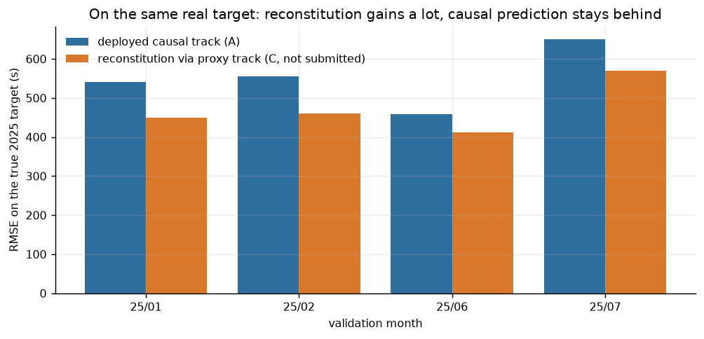
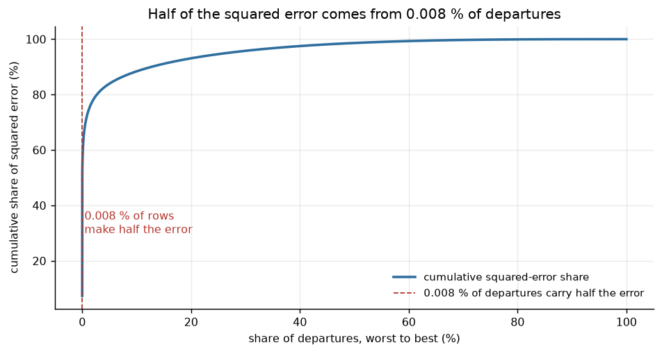
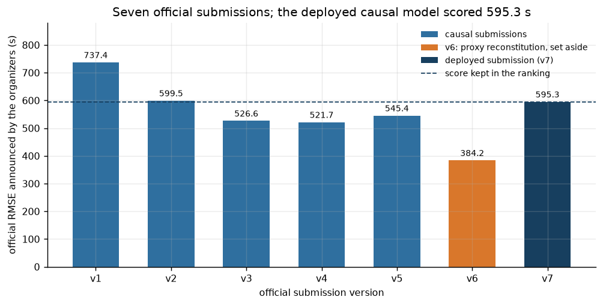

# Decisions — dated log, with the measurement that justifies each one

Convention: a decision carries a number `D‑xxx`, its date, its status (adopted / revised /
cancelled), the measured evidence, and what would make it wrong.

## D‑001 — Two separate tracks, never an implicit mixture (2026‑10‑09, adopted)

The rules set no prediction instant but `MVT_TIME_UTC_mvt` is provided in the finals entries. Rather
than deciding by a silent assumption, the project maintains a **causal** track (prediction in the
sense of the task) and a **reconstruction** track, each named in every report. Revisable if the
organizer specifies the prediction instant.

## D‑002 — `MVT_TIME` and `AOBT_3` excluded from the causal track (adopted)

Evidence: the proxy `MVT_TIME − AOBT_3` reconstructs the target to 384,9 s against 677–740 s for
`EOBT_1/IOBT/LOBT`. Those three therefore stay in the causal track (planning fields); `AOBT_3` and
`MVT_TIME` are reserved for reconstruction. Leak test: setting these columns to NaN does not change
the causal variable matrix in any way.

## D‑003 — real `RUNWAY_mvt` excluded from the causal track, variant measured (adopted)

Estimated cost low outside LSZH/LTFM/EHAM; the variant with the runway actually used is run as a
separate recipe in order to price the gap rather than assume it.

## D‑004 — The default submission remains the causal track (adopted, upload decision)

Justification: the task asks to *predict* the taxi time; a track that uses the provided take-off time
would produce a score whose meaning is not the same. The reconstruction track is developed, measured
and documented, and will only be uploaded on an explicit decision — the official ranking does not
distinguish the two, which is precisely why the decision must be written here before the upload is
made.

## D‑005 — Internal reserve November + December 2025 (adopted)

Development folds = January, February, June, July 2025 (the target months of the finals). November
and December serve neither training nor tuning; a single opening after the freeze.

## D‑006 — Unweighted overall RMSE as the single criterion (adopted)

The official metric is an RMSE over all rows; the average of the monthly RMSEs can lead to the
opposite choice (dedicated test).

## D‑007 — No row dropped from the validation score (adopted)

The organizer removes none of them. Silently excluding the difficult rows would inflate the score
without improving the submission. The error distribution is reported separately.

## D‑011 — Outlier targets stay in training under L2 (2026‑10‑09, adopted after measurement)

- Initial hypothesis: the 768 dev rows > 7200 s (0,04 % of the rows, 53–56 % of the squared error)
  are noise; excluding them should help.
- Measurement: training filtered to 60–7200 s → **570,1 s** against **557,1 s** without the filter
  (`causal-r4-filtered` vs `causal-r2`): the filter costs 13 s (+2,3 %) and makes the model blind on
  the tail that dominates the RMSE.
- Decision: `train_filter = false`. The RMSE targets the conditional mean; removing the tail from
  training shifts the prediction towards the median, which is penalized.
- Becomes wrong if: the organizer removes these rows from the RMSE computation (nothing says so).

## D‑012 — The proxy serves as a variable and a base, not as a linear competitor (adopted after measurement)

| recipe | overall dev RMSE | excluding outlier targets |
| --- | ---: | ---: |
| causal (`causal-r2`) | 557,1 | 382,8 |
| analytic reconstruction + clipping (`hybrid-r2`) | 566,6 | 373,9 |
| airport-weighted linear stacking | 538,3 | — |
| proxy as a **variable** in LightGBM (`hybrid-model-r1`) | **490,8** | **283,0** |

Analytic clipping hurts (it flattens the tail); linear stacking brings only 19 s because both tracks
are wrong on the same rows. Hence `D‑013`.

## D‑013 — Proxy-residual formulation, without clipping (2026‑10‑09, **hypothesis reduced by measurement**)

Starting idea: the proxy carries the same outliers as the target, so predicting
`cible − (proxy + biais aéroport)` would avoid extrapolating on the extreme rows.

Measurement on the dev (`hybrid-model-r1`, 768 outlier rows = target > 7200 s or ≤ 60 s):

| population | n | proxy present | raw-proxy RMSE | model RMSE |
| --- | ---: | ---: | ---: | ---: |
| LIRF outliers | 197 | **13 %** | 6 564 | 22 017 |
| all outliers | 768 | **37 %** | 3 312 | 11 859 |
| LIRF normal | 51 730 | 99 % | 584,5 | 603,2 |
| all normal | 670 524 | 99 % | 400,0 | **283,0** |

Two conclusions, one of which contradicts the hypothesis:

1. **Where the proxy exists**, the residual anchoring is the right choice: on outlier rows with a
   proxy, the raw proxy achieves 3 312 s where the model in absolute value fails at 11 859 s —
   LightGBM leaves cannot extrapolate beyond their averages.
2. **But** on 63 % of the outlier rows the proxy is *absent* (and 87 % at Rome): the residual
   formulation therefore cannot save them, they land back on the fallback. The expected gain on the
   overall RMSE is real but bounded, not spectacular.

Also worth noting: at Rome, on the *normal* rows, the model (603 s) brings almost nothing compared
with the raw proxy (584 s) — the airport is intrinsically very variable.

## D‑014 — LIRF is the dominant lever, treated as such (adopted after measurement)

Rome accounts for **7,7 % of the rows but 70,7 % of the total squared error** in dev (RMSE 1 484 s
against 187–454 s elsewhere). Any overall improvement will come through Rome: a dedicated model or
regularization, and not through further global tuning (both global variants tested, `causal-r4` and
`causal-r5`, **degraded** the score).

## D‑015 — Log target for the tail unreachable by the proxy (2026‑10‑10, **closed again by measurement**)

On outlier rows without a proxy, no track can read the actual value; the only question is whether
causal variables (planned delay, slot, season) announce a disproportionate taxi time. A target
transformed with `log1p` lets the model output extreme values without the leaves staying stuck below
the mean, which the linear formulation forbids.

**Measurement (D‑028).** The hypothesis was tested where its mechanism necessarily had to appear: in
the no-network-record pocket, with a model devoted to it. `log1p` + L2 gives 473,1 s against 449,8 s
in January (+5,2 %). The cause is not the idea but the loss of coherence with the metric: L2 on
`log1p` estimates a geometric mean and `expm1` reinjects it too low on a heavy-tailed target
(retransformation bias). Corrected to Tweedie — which predicts in seconds without transformation,
while accepting a variance increasing with the mean — the variant becomes neutral again (481,6 s,
+0,4 %), so still without any gain.

A global variant (all rows, log target) was **not** run, and this choice is deliberate: the official
metric is an RMSE, that is, an arithmetic mean of squares in seconds; optimizing a geometric mean
over all rows would be badly aligned with the score even if the tail were better drawn. The targeted
test was enough to settle the mechanism. **Verdict: rejected.**

## D‑016 — Network pressure at the destination: variable measured then disabled (2026‑10‑09, rejected)

Idea: a flight whose arrival airport is saturated is held on the ground; we therefore add the number
of *planned* arrivals and departures at the destination in the same slot (`dest_arr_sched`,
`dest_dep_sched`) — a causal variable, available in the finals entries.

| recipe | without the variable | with | gap |
| --- | ---: | ---: | ---: |
| residual (`residual-r1` → `residual-r2-dest`) | 479,9 | 494,9 | **+3,1 %** |
| causal (`causal-r2` → `causal-r7-dest`) | 557,1 | 556,7 | −0,1 % (not conclusive) |

Decision: variable kept in the code but **disabled by default**
(`features.dest_pressure = false`, carried by `FeatureSpec` and serialized with the model), because
it is at best neutral and clearly harmful as soon as a proxy serves as the base.

Method lesson, recorded because it skewed a measurement: the first causal run (`causal-r6-dest`,
569,1) was actually comparing *filter enabled* against *filter disabled* — the base configuration had
kept `train_filter = true` even though D‑011 had rejected it. The score reproduced
`causal-r4-filtered` (570,1) to within 1 s, which revealed the confusion. Since then:
`configs/tabular_causal.toml` carries `train_filter = false`, and every comparison between recipes
first checks that the configurations differ only by the factor being tested.

## D‑017 — Freeze iteration count taken from the median of the development folds (adopted)

Without a validation set at freeze time, `train_final` cannot do early stopping: it takes the median
of the `best_iteration` of the four folds (`--from-report`), a value recorded in `meta.json` with its
source. Measurement in progress (`residual-r3-long`): at 4000 iterations, early stopping had never
triggered — if a longer volume improves development, the median of the folds will follow
automatically.

## D‑018 — The silent crash of two runs was a code defect, not a machine limit (2026‑10‑09, resolved)

Symptom: two trainings killed by `SIGKILL` (code 137) with no error trace, apparently for lack of
memory — while the machine has 512 GB and about 300 GB free.

Measurement: `/usr/bin/time -l` on the faulty run gives a peak of **343 GB** of resident memory,
against 4,1 GB after the fix. The cause is an unintended broadcast: `pd.util.hash_array()` applied to
an array of shape `(N, 1)` returns `(N, 1)`, so that the following comparison built a boolean matrix
`N × N` (≈ 24 billion cells).

Corrections applied:
- `id_bucket()` replaces the hashing (deterministic modulo on the identifier), rejects any input that
  is not one-dimensional or not finite, and an assertion check verifies the shape of the masks;
- three non‑regression tests (`tests/test_residual_gate.py`), including the one that reproduced the
  matrix broadcast exactly;
- resident memory is now measured with `/usr/bin/time -l` during long runs, instead of relying only
  on the report's self-measurement.

Recorded lesson: a `SIGKILL` without a trace must not be attributed to the machine before the actual
memory footprint of the process has been measured.

## D‑019 — Output post-processing: floor at zero, no ceiling (2026‑10‑09, adopted after measurement)

Measurement on the development predictions (reference RMSE in parentheses):

| post-processing | `causal-r2` (557,1) | `residual-r1` (479,9) |
| --- | ---: | ---: |
| none | 557,1 | 479,9 |
| floor at 0 s | 557,1 (±0,00 %) | **479,4 (−0,10 %)** |
| floor at 60 s / 120 s | 557,1 (±0,00 %) | 479,4 (−0,11 %) |
| ceiling at 20 000 s | 557,1 | 486,8 (+1,44 %) |
| ceiling at 7 200 s | 558,9 (+0,31 %) | 491,9 (**+2,49 %**) |

Decision: `max(prédiction, 0)` only. The floor is free in RMSE terms and removes the negative values
that both tracks produced (23 rows in causal, 71 in reconstruction on the 2026 template). Any ceiling
is forbidden: it flattens precisely the extreme values that weigh most in the RMSE — third
confirmation of the same effect (after D‑011 and D‑013).

## D‑020 — Correction of a wrong reading: the template is float64, not int32 (2026‑10‑09)

The data dictionary noted `TAXITIME_SEC_mvt` as `int32` for the finals template. That is correct for
the **training** files, wrong for the **template**: both template columns are `float64` (with `NaN`
to fill). Verified on the file, and the submission check had reported it as a warning on the first
generations.

Correction: `src/predict.py` no longer hardens any type, it reuses `template["TAXITIME_SEC_mvt"].dtype`.
The two produced files now pass without error **or warning**. The zero floor was applied after the
fact, hence a new SHA‑256 fingerprint for both submissions.

## D‑021 — Adding two witness months to the rotation (2026‑10‑09, adopted)

Request from the project lead: widen the rotation rather than move the reserve.

- `configs/splits.toml` receives `witness_months = ["2025-03","2025-10"]`; `Protocol.witness_folds()`
  and the `--witness` / `--split witness` options train them under the same conditions as the normal
  folds (same training months, same fallback, no shared tuning).
- **Discipline rule**: these months never break a tie between two recipes. The selection criterion
  remains the rotation over January/February/June/July; the witnesses only widen the estimate and
  show that a win is not a seasonal accident. The reserve (November + December) stays closed and
  keeps its role as a single uncontaminated figure.
- Measurement: causal 355,0 s and reconstruction 278,7 s on March + October — months easier than the
  target months, which explains why the pooled estimate drops as soon as they are added (497,2 s and
  421,9 s over six months against 557,1 s and 479,9 s over four). Both figures are useful, but for
  the finals ranking **it is the four target months that represent the task**.

## D‑022 — A training-free reference file as a comparison anchor (2026‑10‑09, adopted)

Need: link our local measurements (2025) to the official score (January + July **2026**) without
turning submissions into a leaderboard measuring instrument.

- Provided file: `proxy brut + biais par aéroport`, a simple and transparent method, **with no
  learning at all** (`configs/tabular_hybrid_noclip.toml`, airport‑hour mean fallback). Known local
  RMSE: **591,7 s** over the four target months (643,6 s over January + July; 379,0 s excluding
  outlier rows).
- Usage: the official score of this file gives a **transfer factor** between our local measurements
  and the reality of the leaderboard, applicable to the two other files. One point, documented in advance.
- Guard‑rails: no upload "just to see", no iteration guided by the leaderboard (official
  rule on exploiting the ranking process); the five daily uploads are not consumed on
  explorations.
- **Clean‑room**: the scores of an earlier session on this same challenge (the project lead mentions
  ~521 s in causal and ~385 s in residual proxy over January + July) were **neither read, nor
  recovered, nor used** by this repository. They serve no modeling or tuning decision. The comparison
  is moreover delicate: an official score and a local RMSE are comparable only if the population, the
  months and the included rows are identical — our local figures over January + July 2025 are 603,5 s
  (causal) and 519,9 s (residual), which suggests that the figures he remembers corresponded to
  another population (or to a scope excluding outlier rows). That is exactly the ambiguity that the
  reference file allows us to resolve.

## D‑023 — Single opening of the internal reserve (2026‑10‑10 06:17 +0200, executed)

The recipes had been frozen since 9 October (models trained on January → October only, iterations
set by the median of the development folds, D‑017). The three recipes concerned were evaluated **in
a single command**, because the `reports/RESERVE_OPENED.json` marker forbids any later opening —
otherwise the first evaluation would have consumed the reserve for a single
recipe.

November + December 2025, **328 009 departures, no row excluded**:

| recipe | reserve RMSE | excluding outlier rows | bias |
| --- | ---: | ---: | ---: |
| constant prediction (training mean, 990,3 s) | 523,4 | 413,1 | — |
| reference file (proxy + bias, training-free) | 470,0 | 344,3 | +3,4 |
| **prediction** (frozen causal) | 432,8 | 342,5 | +8,3 |
| **reconstruction** (proxy + correction, frozen) | **353,9** | 237,3 | −13,1 |

What this confirms: the advantage of reconstruction is found again on data never touched (−18,2 % vs
causal here, −13,9 % in development, −21,5 % on the witness months). It is not an artifact of the
choice of recipes.

What it does not say: the expected level on the finals. November and December are **easier** months
than January/February/June/July (432,8 s against 557,1 s for the same causal model); the months
targeted by the ranking remain the hardest in our sample.

**Discipline after opening**: no tuning, no new variable, no recipe change will be decided from these
figures — they serve only to estimate. If an improvement were attempted afterwards, the reserve would
lose its value and would have to be considered as development. The upload therefore stays exactly in
the frozen state, with the exception of renaming the files.

## D‑024 — Audit of the two off‑block sources, without filtering or down‑weighting (2026‑10‑10, adopted)

Proposal from the project lead: use the realized `_flt` fields as an **audit tool** for the training,
never as an input to the predictor before departure; compare three trainings (all rows / exclusion of
suspect cases / down‑weighting); evaluate each model on the same held‑out month, official target
intact; report agreeing, disagreeing and no-network-information rows separately. Full detail and
tables: `reports/AUDIT_SOURCES.md`, tool `src/audit.py`.

What the audit establishes (2025 target months, 671 292 rows):

* taxi times beyond two hours are **not corroborated**: of 259 rows, **only one** agrees between the
  two sources, 20,1 % are in strong disagreement, **79,5 % have no network record at all** — and this
  result does not move when the thresholds are varied from 600/1200 s to 1800/3600 s;
* the total ground time of these flights (take-off − scheduled time) really is 2,5 h or more: the
  enormous value is not a crazy clock, it is a disputed **attribution** between waiting before
  pushback and taxiing after pushback (median gap +2 215 s, the network placing the pushback ~37 min
  later);
* the dominant error pocket is precisely the one that cannot be audited: 1,34 % of rows without
  network information carry **54,9 %** of the squared error in causal and **73,9 %** in residual;
* the "strong disagreement" class — the only one on which filtering or down‑weighting could act —
  accounts for only 0,61 % of the rows and 9,8 % / 6,2 % of the squared error.

Decision: **no filtering, no down‑weighting based on source agreement**, and the three compared
trainings are not run — the reason is quantified above (lever bounded to the smaller of the two error
pockets), not ideological. Two additional reasons, of a methodological nature:

1. filtering on source agreement would make the training **less representative** of the population
   actually ranked, which contains these rows;
2. the competition target remains that of the movements: discarding labels that seem doubtful to us
   is optimizing another problem than the one graded (same measured effect as in D‑011: +2,3 %).

On the other hand the audit **confirms and refines** two choices already taken: do not clip at the top
(D‑013, D‑019), and consider that the superiority of the reconstruction track concerns the auditable
agreeing rows — where it goes down to 193,4 s against 306,2 s in causal — and not the extreme rows,
where it falls back on the causal fallback (identical RMSE by construction).

## D‑025 — Pre‑registered adoption rule for the trials targeting the no-network-information pocket (2026‑10‑10, written BEFORE any run; **executed → results in D‑028**)

Context: the audit (D‑024) shows that 1,34 % of departures have **no** network information — the
eleven `_flt` columns are 100 % absent there, including in the finals entries (1,35 % of the rows).
This pocket carries 54,9 % of the squared error in causal and 73,9 % in residual. Two trials are
therefore justified:

1. a **regime indicator** (`regime_sans_reseau`) in the causal track, so that the trees specialize
   their leaves instead of drowning this regime under `NaN`;
2. a **specialized model** on the rows without network information only (19 465 training rows), with
   a target transformed with `log1p` so that the leaves can reach extreme values, used as the
   fallback instead of the generic causal model in the residual track.

**Adoption criterion, fixed before looking at any result:** the variant is adopted only if its RMSE
is **at least 2 % lower on each of the four target months** (January, February, June, July), computed
on **100 % of the rows**, official target intact. Otherwise it is refused and the frozen files remain
the provided ones. No secondary criterion (error per category, model aesthetics) can save a variant
that fails this test.

Why so clear-cut a threshold: with 74 % of the squared error concentrated in 1,34 % of the rows, the
RMSE of a month is very sensitive to a few dozen flights. A gap of a few tenths of a percent is not
a signal — it is sampling noise, and our usual 0,5 % threshold was too lax for that metric (an
assumed scope correction, see D‑026).

**What remains true after a possible adoption**: the internal reserve is consumed (D‑023), so any
recipe modified here is judged on development only. If a variant were retained, `DECISIONS.md` should
say so explicitly, with the timestamp of the re-freeze and the fingerprint of the new files.

## D‑026 — Scope correction: our comparison threshold was too tight for this metric (2026‑10‑10)

The first arbitrations treated a gap below 0,5 % as not conclusive. That was reasonable on average,
but too weak as a guard‑rail given the concentration measured in D‑024: the RMSE of a held‑out month
is dominated by a handful of rows whose label is single-source. The decisions already taken are not
shaken by this — the refused gaps were in the "change nothing" direction (conservative), and the
adopted ones (D‑012 −11,9 %, D‑013 −2,2 %) exceed the new threshold — but the rule becomes 2 % per
month on all target months for any future adoption.

## D‑027 — Presentation order distinct from the order of discovery (2026‑10‑10)

The source audit should have preceded the modeling; it came afterwards, and two experiments were run
for nothing (D‑011 filtering, D‑016 destination pressure). An assumed choice: **the decision log
keeps the real chronological order** (that is the honest trace, with its failed measurements), while
the `README.md` follows the pedagogical order — data diagnosis before model choices. A reader must be
able to see in what real order things were learned: this note exists for that purpose.

## D‑028 — The three attacks on the no-network-information pocket are measured and refused (2026‑10‑10, executed)

The trials planned in D‑025 were carried out, plus two variants added along the way because the first
one failed for an understood reason. The criterion remained the one written before execution: **−2 %
on each of the four target months**, on 100 % of the rows (`scripts/check_adoption.py`, which applies
the rule mechanically and refuses to conclude if the populations differ).

| variant | January | February | June | July | overall | verdict |
| --- | ---: | ---: | ---: | ---: | ---: | --- |
| reference (frozen) | 449,8 | 459,6 | 412,3 | 570,2 | **479,9** | — |
| regime indicator, causal track (`causal-r8-regime`) | +0,34 % | +0,19 % | +0,07 % | −0,02 % | 557,8 (vs 557,1) | refused 0/4 |
| `log1p` specialist (`residual-r5-spec`) | **+5,18 %** | — | — | — | abandoned at fold 1 | refused |
| raw specialist, L2 on seconds (`residual-r5-spec-raw`) | +5,46 % | +1,44 % | +4,07 % | +3,86 % | 497,9 (+3,8 %) | refused 0/4 |
| Tweedie 1,3 specialist (`residual-r6-spec-tweedie`) | +0,14 % | −0,06 % | +1,18 % | +0,26 % | 481,6 (+0,36 %) | refused 0/4 |

Three lessons, in the order they were understood:

1. **The regime indicator learned nothing new.** The causal track already contained `miss_EOBT_1_flt`,
   `miss_IOBT_flt`, `miss_LOBT_flt` — created for a completely different need. The trees therefore
   already knew how to separate the regime; the added flag is redundant (gap ≤ 0,34 % everywhere).
2. **The specialist's first failure was a statistical defect, not the idea.** `log1p` + L2 estimates a
   geometric mean, and `expm1` reinjects it too low on a heavy-tailed target: that is the retransformation
   bias. Tweedie — which predicts directly in seconds — erases almost the whole handicap (+3,8 % →
   +0,36 %). The correction was therefore the right one; the remaining idea still yields nothing.
3. **Specialization hurts, and two independent measurements say so.** Recycling the fallback towards
   the airport mean gains nothing (λ = 1 is optimal: pool 3 566,7 s against 3 566,5 s at λ = 0,85,
   then it degrades) — so the generic model is not overfitting on this pocket. And in this pocket,
   **the worst 1 % of rows carries 81 to 93 % of the squared error**, with targets up to 131 167 s:
   a model trained on ~20 000 rows of this regime loses more in generality than it gains in
   knowledge of the regime.

**What the audit therefore actually yielded**: not one point of RMSE, but a **measured lower bound**.
On rows without a network record, our fallback achieves 4 026 / 4 411 / 2 908 / 3 502 s per month;
the airport mean would give 4 106 / 4 465 / 2 959 / 3 579 s there and the overall mean 4 282 / 4 744
/ 3 252 / 3 834 s. We are already close to the attainable floor without knowing *which* of these flights
will stay blocked for twenty‑four hours — information that **no** provided column contains, not even for the network.

**Frozen files unchanged.** None of the three runs was adopted; the three submissions of section 10
remain bit for bit the provided ones (fingerprints verified after these trials). Reserve still
closed: these variants were judged on development, as D‑023 requires.

## D‑029 — Combined adoption rule for the trials that follow (2026‑10‑10, written before the results of D‑031)

The D‑026 threshold (−2 % on each of the four target months) does protect against noise, but it
measures *raw* noise and not the *consistency* of a gain. An improvement spread over the whole
ordinary mass can legitimately yield −1 % over the four months: it is no accident that all four
months move in the same direction, and D‑026 would reject a genuine improvement.

**New rule, applicable to trials started after this entry**:

1. the variant's RMSE is **at least 1 % lower on each of the four target months** — not three out of
   four, not the average;
2. a **paired bootstrap** over the rows (2 000 draws, per-month resampling of the squared-error
   differences between reference and variant) gives a 95 % interval on the RMSE ratio whose upper
   bound is **strictly less than 1**;
3. both conditions simultaneously, computed by `scripts/check_adoption.py --bootstrap`, with no
   comfort exception: a variant failing either one is refused, even if its mechanism looks elegant.

Why this is stronger and not merely looser: D‑026 required a large effect because it had no measure
of significance; here significance is computed on the same rows, which removes most of the sampling
noise that motivated the 2 % threshold. The number of attempted trials remains recorded in full in
`experiments/REGISTRY.md` — with nine variants already committed on the no-network pocket alone,
this is the only useful defense against self‑suggestion.

## D‑030 — Projecting the official score without labels: useful in relative terms, **invalid in level** (2026‑10‑10, measured)

**Question asked**: can we estimate our official RMSE over January + July 2026 *before* submitting,
without touching the leaderboard? Partly yes. In the official entries, `MVT_TIME_UTC_mvt` and
`AOBT_3_flt` are present: the proxy is therefore computable while the target is masked. We measure
the difficulty distribution of the 2026 population (proxy bands × Rome/other, plus the
no-network-record pocket) and replay our conditional error profile on it, measured on the held‑out
months. No 2026 label exists or is used; no score is requested from the leaderboard. Tool:
`src/score_projection.py` → `reports/SCORE_PROJECTION.{md,json}` (11 s of computation).

**Guard‑rail written before execution**: back‑validation — replay the procedure on a development
month pretending to ignore it. The level is declarable only if the gap to the truth stays ≤ 5 %.

| held‑out month | projected | actual | gap |
| --- | ---: | ---: | ---: |
| 2025‑01 | 360,4 | 449,8 | −19,9 % |
| 2025‑02 | 360,6 | 459,6 | −21,5 % |
| 2025‑06 | 510,5 | 412,3 | +23,8 % |
| 2025‑07 | 641,4 | 570,2 | +12,5 % |

**The guard‑rail falls: maximum gap 23,8 %, residual dispersion σ = 0,233 in log, i.e. an uncertainty
factor of ×1,58 on the level.** This is not a binning defect: going from 7 to 11 bands in the tail
changes almost nothing (23,8 % → 22,7 %). What varies from one month to another is not the *frequency*
of disproportionate flights but their *magnitude*, and it is written in no column — it is the same
wall as D‑024, met again from the other side.

**Declared usable usage**: comparing months with each other, and measuring a population drift.
Forbidden: announcing an absolute level.

| population | no network record | proxy > 1 h | Rome | proxy p99 | projected RMSE (full interval) |
| --- | ---: | ---: | ---: | ---: | ---: |
| January 2026 | **1,61 %** | 0,369 % | 7,24 % | 2 637 s | 450,9 [285,6 ; 712,0] |
| February 2026 | 0,92 % | 0,078 % | 7,12 % | 2 103 s | 395,7 [250,6 ; 624,8] |
| June 2026 | 1,36 % | 0,164 % | 8,24 % | 2 099 s | 470,0 [297,6 ; 742,1] |
| July 2026 | 1,48 % | 0,177 % | 8,24 % | 2 049 s | 564,8 [357,7 ; 891,9] |
| **Jan. + Jul.** | — | — | — | — | **517,5 [327,7 ; 817,2]** |

Honest reading of the 385 s target: the central projection would require **−25,6 %** RMSE, but the
lower bound of the interval (327,7 s) is **already below the bar**. In other words, 385 is not out of
reach by some accident of population — it is exactly the kind of question that one leaderboard reading settles.

**Operational consequence, and this is the main contribution of this decision**: the reference file
(proxy + bias, training-free, local RMSE known in advance: 591,7 s over the four target months,
643,6 s over January + July) becomes the **measuring instrument** that converts this ×1,58 interval
into an observed transfer factor. Cost: one submission slot out of the five daily ones (D‑009). It
must therefore be submitted **first**, before any other submission.

## D‑031 — Calibrating the `proxy → cible` base per airport (2026‑10‑10, **refused after measurement**)

**Measured observation first.** The proxy is a *noisy measurement* of the off‑block: regressing the
target on it gives an overall slope of **0,691**, not 1. The base used since `residual-r1` (`proxy +
constante par aéroport`) therefore leaves a systematic error that grows with the gap — exactly the disagreeing
tail where our measured bias is −927 s (D‑024). On the rows with a proxy only, four held‑out months:

| base | pooled RMSE | January, rows > 1 h |
| --- | ---: | ---: |
| `proxy + constante` (frozen recipe) | 385,4 s | 1 949 s |
| per‑airport line (`a + b·proxy`) | 367,2 (−4,7 %) | 1 392 s |
| per‑airport isotonic | **361,4 (−6,2 %)** | — |

**What is implemented**: `fit_calibration` / `apply_calibration` in `src/reconstruct.py`, mode chosen
by `[reconstruct] calibration` = `constante` (default, frozen recipes unchanged to the bit) |
`lineaire` | `isotonique`. Explicit hierarchical fallback: airport (if ≥ 5 000 training rows) → global
line → global isotonic safety net. The calibration is learned **only on the fold's training months**,
and travels in `state.json` (earlier states, lacking the key, stay in constante mode).

**Adoption criterion, written before execution**: D‑029 — RMSE at least 1 % lower on **each** of the
four target months, and a paired bootstrap interval excluding 0.

**Measurement (four folds, D‑029 rule)**:

| variant | January | February | June | July | overall | paired bootstrap | verdict |
| --- | ---: | ---: | ---: | ---: | ---: | --- | --- |
| `residual-r1` (frozen, constante) | 449,8 | 459,6 | 412,3 | 570,2 | **479,9** | — | reference |
| per‑airport line (`residual-r8-calib-lin`) | +0,10 % | +0,39 % | −0,12 % | −0,02 % | 480,2 (+0,06 %) | CI95 [0,9999 ; 1,0016] | refused (neutral) |
| per‑airport isotonic (`residual-r7-calib-iso`) | +0,07 % | +0,46 % | +0,00 % | **+5,10 %** | 490,4 (+2,18 %) | CI95 [0,9997 ; 1,0749] | refused (harmful) |

**Why the −6,2 % measured on the base alone does not carry over**: the model already sees `proxy_sec`
as a variable. The attenuation slope that the constant ignored, it learned by itself; calibrating the
base moves the work from the base to the model without adding anything to the total — the line shows
it exactly (+0,06 %, interval glued to 1). The isotonic adds damage of its own: learned on the core
(60–7200 s), it flattens beyond its domain and **in effect clips the extreme values** that we wanted
to reach — hence July at +5,1 %, the month where Rome weighs most, therefore the richest in tail.

**What this decision closes**: the systematic underestimation of disagreeing rows (−927 s, D‑024) is
**not** an artifact of base calibration. It persists when this calibration is corrected with the full
line. It stems from the attribution of the waiting before pushback — not from a tuning we could make.
The code remains available (`[reconstruct] calibration`, default `constante`) for reproduction,
covered by `tests/test_calibration_base.py`; **the frozen recipes are unchanged** and so are the three
provided files (fingerprints reverified after these trials).

## D‑032 — Multiple seeds: not run, and why (2026‑10‑10)

Averaging five seeds typically reduces the RMSE by a few tenths of a percent. Under the D‑029 rule
(−1 % on **each** of the four months), a gain of that size is not adoptable, and justifying it by
stability alone would be changing the criterion after the fact. We record it as an unexecuted option
rather than passing it off as a result. If submitting the reference file (D‑030) shows that the 2026
population is close to our development months, the computation becomes interesting again: it would
then have a quantified target to reach rather than a vague comfort.

## D‑033 — Specialization on the tail: ceilings computed before execution, **variant run and refused** (2026‑10‑10)

The idea to test (proposed by the team): a model **specialized** on the difficult rows of the
reconstruction, where the proxy is present but bad. Before launching any training, we measured **what
a specialization could gain at best**, with the frozen model `residual-r1` and its retained
predictions (no retraining for this diagnostic).

Two candidates are **killed by the arithmetic**, not by a failure:

| region | definition | share of rows | model RMSE | share of squared error | ceiling if the RMSE were halved |
| --- | --- | ---: | ---: | ---: | ---: |
| proxy magnitude | `proxy ≥ 1 800 s` | 2,97 % | 506 s | **3,4 %** | −0,84 % → below the D‑029 criterion |
| strong disagreement | `\|AOBT_3 − LOBT\| ≥ 60 min` | 0,28 % | 1 113 s | 1,5 % | −0,38 %, and only **3 993 training rows** |
| no network record | no `_flt` column | 1,34 % | 3 567 s | 73,9 % | already attacked three times, refused (D‑028) |

In other words: "specializing on long taxi times" has no grip — when the proxy is huge, the model is
already good (499 s between 30 and 60 min of proxy). The error does not live there.

**The only candidate with a high enough ceiling** is the region `|AOBT_3 − LOBT| ≥ 30 minutes`: 5,1 %
of the rows, 6,3 % of the squared error, **80 991 training rows**, and a disagreement computable in
operations (both columns are present in the finals entries). Halving its RMSE would be worth −3,1 %
overall; a realistic specialist targets 10 to 20 %, i.e. **−0,6 to −1,2 %**.

**What is run**: `residual-r9-tail-desac` — a second model trained on the rows in disagreement of at
least 30 min only, target identical to the main model (the gap to the base), applied only to those
rows. Base, features and everything else unchanged; behind `--tail`, disabled by default, therefore
a **zero‑cost step back**: the frozen recipes and the three provided files are untouched.

**Adoption criterion**: D‑029, without relaxation (−1 % on each of the four target months **and** a
paired bootstrap interval excluding 1).

**Result (four folds, D‑029 rule)**: refused. Overall 480,4 s against 479,9 s (+0,10 %), bootstrap
ratio [1,0006 ; 1,0017]. And above all, the diagnostic that closes the question:

| region | n | reference | with specialist | gap |
| --- | ---: | ---: | ---: | ---: |
| disagreement ≥ 30 min (the specialist's target) | 34 553 | 533,0 s | **541,7 s** | **+1,63 %** |
| disagreement < 30 min (untouched) | 627 755 | 220,4 s | 220,4 s | 0,00 % |

The specialist therefore did modify only the targeted rows — and it **lost** there. The announced
failure mode materialized as such: in this region the reference model is already unbiased (−25 s),
its error is variance; training on 81 000 rows instead of 1 750 000 degrades generalization more than
it adds knowledge of the regime. It is the third convergent result after D‑028 (no-network-record
pocket, +3,8 %) and D‑031 (base calibration, neutral): **on this data, specialization yields nothing.**

**Step back performed, at zero cost**: the mechanism stays behind `--tail` (disabled by default), the
frozen recipes and the three provided files are unchanged to the bit (fingerprints reverified afterwards).

**Method decision that follows this trial**: we stop the tuning. Eleven variants measured, zero
adopted, and the ceilings computed in D‑033 show that nothing remains to be gained on this side
without exceeding our own criterion. The unknown that now dominates — the transfer from our local
measurements to the leaderboard — is lifted not by computation but by an upload: reference, reconstruction, prediction (D‑030).

## D‑034 — Rereading the rules, 2026 arrival labels, and a scale defect in our own code (2026‑10‑10)

Three discoveries on the same day, each with its correction. They come from a rereading of the
official pages requested by the team, not from tuning.

**1. The ranking grades only January and July 2026.** "The applied ranking will use Root Mean Square
Error (RMSE) for submitted predictions for the movements in **January and July 2026**" (home page).
The template does cover four months and the script rejects any missing or extra row — we therefore
still fill all 670 790 rows — but **the main decision criterion becomes January + July combined**,
the four months remaining the stability check. `RULES.md` is up to date; the
`scripts/check_adoption.py` tool keeps the four months as a guard-rail and our reports now cite both
readings.

**2. There are two pairs of evaluation files, and they carry a 2026 truth.** The September pair
(`ranking.parquet`, `submitting.parquet`) covers January + July 2026 on the 8 platforms of the
previous phase; its identifiers are a strict subset of `final_ranking` (689 534 out of 689 534).
Above all, **the arrivals there are labelled 100 %**: `final_ranking.parquet` provides **670 407
actual arrival taxi‑in times** over our ten platforms and the four months. No departure is labelled
in 2026 — the internal reserve therefore stays closed and no adoption rule changes.

First use, as a drift check (same airports, same months, 2025 versus 2026):

| month | 2025 median | 2026 median | gap | share > 10 min 2025 → 2026 |
| --- | ---: | ---: | ---: | ---: |
| January | 486 s | 487 s | +0,2 % | 34,3 % → 34,0 % |
| February | 477 s | 484 s | +1,5 % | 31,7 % → 33,4 % |
| June | 483 s | 479 s | −0,8 % | 33,7 % → 32,6 % |
| July | 486 s | 470 s | −3,3 % | 34,8 % → 30,4 % |

The 2026 population is **stable to ±3 %**: the hypothesis of a much milder 2026 (suggested by the
proxy projection alone) is **refuted** on actual labels. Per platform, the gap stays modest
(LTFM −6,1 %, EDDF −3,8 % downward; LEBL +3,5 % upward).

**Along the way, an error on our side, recorded because it produced wrong figures in the day's
conversation:** a wrong airport list (EGKK, LSGG, LOWW, LIME, EKCH, ESSA, ENGM…) was used for an
ad‑hoc analysis; the real ten are EDDF, EDDM, EGLL, EHAM, LEBL, LEMD, LFPG, LIRF, LTFM, LSZH. No file
of the project contained the wrong list (`RULES.md` and all the reports were right); the arrival
figures quoted before this decision (3 platforms) are therefore **cancelled and replaced** by the
table above.

**3. A scale defect in `src/prepare.py`.** `epoch()` computed `astype("int64")/1e9`, which assumes a
nanosecond resolution; the columns are parsed as `datetime64[us]`, so the function was returning
**milliseconds**. Measured consequence: `slot()` reduced a whole month to **4 slots** instead of
~2 976, and all the planned-congestion counters (`arr_prev/now/next`, `arr_load_ratio`, `dep_now`)
had become quasi meaningless constants — harmless, but useless. Fixed via `total_seconds()` (exact
whatever the resolution), test added (`tests/test_observed_traffic.py`).

**What the correction changes on the score, measured**: `causal-r12-epochfix` redoes the four folds
with the right scale → 558,7 s against 557,1 s (+0,3 %; January +1,9 %, February −0,05 %, June
+0,4 %, July −0,5 %). **Not adoptable** within D‑029: the correct counters bring nothing measurable
above noise, which is consistent with the fact that planned congestion was already redundant with
the hour and the airport. The correction is therefore kept for what it is — a **correctness**, not a gain.

**Reproduction guaranteed despite everything**: `FeatureSpec` now carries an `epoch_seconds` flag,
false by default. The frozen specifications (and therefore `src.predict`, `src.train_final`)
reproduce the old scale; verified by redoing the January fold (`causal-r13-repro`: **540,0 s**,
identical to `causal-r2`). The provided files therefore remain regenerable identically, and the new
runs (`src.refattente`) explicitly request the right scale. It is the third defect of our own code
found, measured and recorded after D‑018 (N×N hashing) and D‑020 (template dtype).

## D‑035 — What a "defensible without discussion" version costs: measured by retraining (2026‑10‑10)

Question asked by the team: if we refused to assume that the parking stand (`STAND_mvt`) and the last
known pushback time (`LOBT_flt`) are available at t0, how much would it cost? The audit
`T0_DISPONIBILITE.md` answered with an erasure at inference time (+8,5 % for the stand); this
decision brings the strong measurement: **full retraining**, four held‑out folds, everything else unchanged.

**Reading rule written before execution**: the purified variant would be retained if its cost stayed
≤ 1 % overall and ≤ 1,5 % on each of the four target months. Beyond that, we keep the full version
and the reservation is written in the response document.

| variant | January | February | June | July | Jan.+Jul. | overall | paired bootstrap (variant/reference) |
| --- | ---: | ---: | ---: | ---: | ---: | ---: | --- |
| `causal-r2` (reference) | 540,0 | 555,4 | 459,0 | 650,2 | 603,5 | **557,1** | — |
| without stand (`causal-r10-nostand`) | +2,64 % | +1,58 % | +2,20 % | +1,48 % | **+1,90 %** | 567,6 (+1,88 %) | CI95 [1,0129 ; 1,0265] → **loss established** |
| without `LOBT` (`causal-r11-nolobt`) | +0,10 % | −0,14 % | +0,20 % | +0,01 % | **+0,04 %** | 557,3 (+0,04 %) | CI95 [0,9992 ; 1,0016] → not separable |

**Where the loss of the stand concentrates** (paired rows, per band of actual duration): 0–20 min
(76,4 % of the rows) **+7,96 %**; 20–40 min (22,3 %) +2,27 %; 40–60 min +0,84 %; > 60 min **+0,45 %**.

The team's hypothesis — "the stand weighs little in the belly of the distribution and a lot on the
anomalies" — is **the opposite of the measurement**: the stand is belly information (it says "such
stand at Rome taxis 12 minutes on average, such other one 35"), and the anomalies are explained by no
variable (Fact 4). It is also the end of a hesitation about the upload: removing the stand would cost
~2 % on the prediction file, exactly on the graded months.

**Decision**: variant without the stand **refused** (cost established, twice the threshold); variant
without `LOBT` statistically free (+0,04 %, interval containing 1) but **not adopted** for lack of a
reason to prefer it — we keep `LOBT` and we record this fact in the admissibility argument: *if an
organizer judged `LOBT` too late, its removal would cost nothing measurable*, unlike the stand. Tools:
`configs/tabular_causal_nostand.toml`, `configs/tabular_causal_nolobt.toml`,
`scripts/d035_sensitivity.py`.

## D‑036 — The local → graded-period transfer factor is measured, no longer only projected (2026‑10‑10)

D‑030 had failed to project the official score from the proxy alone (maximum gap 24 %, interval
×1,58). The arrival labels discovered in D‑034 make it possible to do the same measurement **on real
data**, without keeping any hidden target: a recipe trained on 2025 is evaluated twice, on January +
July 2025 (local) then on January + July 2026 (the graded months), with strictly identical training
and no tuning on 2026.

**Criterion written before execution**: if the factor lies in [0,90 ; 1,15], our local figures carry
over without any correction other than the announced interval; otherwise we correct all expectations
by this factor and write it down.

| measurement | RMSE | rows |
| --- | ---: | ---: |
| model (discipline of the prediction track), local 2025 | **271,1 s** | 343 999 |
| same model, graded period 2026 | **289,1 s** | 344 693 |
| measured factor (model) | **1,0666** | — |
| measured factor (reference "smoothed airport mean") | 1,0447 | — |

The factor is therefore about **+5 to +7 %**, and roughly independent of the recipe: the graded
period is slightly harder than our local months, not radically so. Applying this range to our files:

| file | local Jan.+Jul. | expected on the leaderboard (×1,045 to ×1,067) |
| --- | ---: | ---: |
| reference (proxy + bias) | 643,6 | ≈ 672 – 687 s |
| prediction (causal) | 603,5 | ≈ 631 – 644 s |
| reconstruction (proxy + correction) | 519,9 | ≈ 543 – 555 s |

**Limits written, because they matter**: the measurement concerns **arrivals** (taxi‑in), whose label
does not suffer from the attribution problem of Fact 4; the transfer specific to departures therefore
remains unverified, and the interval above covers only the **level shift**, not the uncertainty on
the extremes. A single reading, no tuning behind it (D‑034). Tool: `src/arrival_transfer.py`,
`reports/ARRIVAL_TRANSFER.json`.

**What this changes about the upload strategy**: the measurement upload (reference file) is no longer
the only way to obtain a factor — it confirms one. It remains useful because it concerns **our
departure population**, which the arrivals do not replace.

## D‑037 — "Reference + wait" with actually observed traffic before the anchor: built, measured, **refused** (2026‑10‑10)

The architecture requested by the team: to the existing causal prediction (the "reference": calendar,
airport, aircraft type, stand, operator, stand→runway geometry learned from arrivals) is added a
"wait" computed on the traffic **actually realized strictly before the anchor** — take-offs and
landings passed in windows of 15, 45 and 90 minutes, elapsed time since the last movement,
take-off/arrival ratio. Discipline verified by tests (`tests/test_observed_traffic.py`): windows
strictly before the anchor, futures excluded, and **the flight being evaluated never counts its own
take-off**.

**Result (four held‑out folds, against `causal-r2`)**: 555,4 s against 557,1 s, i.e. **−0,32 %**
overall as on January + July combined; per month, January **+0,87 %**, February −0,68 %, June +0,10
%, July −0,98 %. The nine observed variables do weigh ~11 % of the decisions (up to 3,0 % for
`obs_arr_90` alone) — but do not produce the requested gain. **Refused within D‑029** (it would take
−1 % on each of the four months; two months are slightly degraded).

**Why this result is useful nonetheless**: the *realized* congestion before the anchor brings little
because it is largely redundant with what the model already knows from the hour, the airport and the
flight plan — the same finding as in D‑016 (destination pressure) and D‑034 (planned counters). The
information that is missing is not "how many aircraft moved before", but **why this one stays
blocked**: Fact 4, again and always. The code remains available (`src/refattente.py`) and documented;
the frozen recipes and the three provided files are untouched.

## D‑038 — Closing the audit day: what changes, what does not (2026‑10‑10)

**What this day added to the knowledge of the problem**: the real scope of the ranking (January +
July, not four months — D‑034); the existence of 670 407 2026 arrival labels, which refutes the
hypothesis of a milder 2026 population and provides a measured transfer factor of +5 to +7 % (D‑034,
D‑036); the quantified cost of a "defensible without discussion" version (+1,9 % without the stand,
+0,04 % without `LOBT`, D‑035); a scale defect in our own code, fixed without touching the provided
files (D‑034); and a negative but tool-backed answer to the "reference + wait" architecture (−0,3 %,
refused, D‑037).

**What does not change**: no recipe was adopted today — D‑029 was passed by none of the four variants
measured. The three provided files are therefore **unchanged to the bit**, and this time **proved by
complete regeneration** (2026‑10‑10): the three `src.predict` tracks reproduce their fingerprints to
the byte — `dd005031…` (prediction), `66223d9b…` (reconstruction), `d0ab0cb8…` (reference). Along the
way, a gap in our own documentation was fixed: the command that produces the reference file
(`--track hybrid --config configs/tabular_hybrid_noclip.toml`) was recorded nowhere; it is now in
README §9 and `DEPOT.md`, with the three full fingerprints. The internal reserve stays closed
(opening already consumed). Tuning remains stopped.

**What is ready for what follows**, in `DEPOT.md`: renaming upon receipt of the team name,
validation and fingerprints before sending, measurement upload of the reference file with the expected
range (**≈ 672 – 687 s**, to be compared with the 643,6 s local on January + July — and not with the
591,7 s of the four months), then documented choice of the single `<team>_final.parquet` between the three priced options.

**Documentation updated in the same movement**: `RULES.md` (ranking scope, labelled arrivals,
best submission kept), `DATA_DICTIONARY.md` (missingness rates measured field by field, actual
role of the four evaluation files), `VALIDATION_PROTOCOL.md` (January + July as the main
reading, discipline of the observed windows, framed use of the arrival labels), README (Fact 4 with
the right figures, section 7 on the 2026 truth, limits, reproduction commands),
`experiments/REGISTRY.md` (five new rows). Test suite: **57 tests** green.

## D‑008 — Mandatory deliverables before closing (open)

1. Team name + MinIO keys to upload (blocked: awaiting user — `ATTENTE-` prefixes kept, renaming
   described in `DEPOT.md` step 0).
2. Publishing the code under GPLv3 on GitHub (eligibility requirement). The local git repository is
   **still without any commit** as of 2026‑10‑10: versioning was postponed by the team, it remains to
   be done before any public publication (`git add -A && git commit`, then fork the challenge account).
3. A single `<team>_final.parquet` file to produce after the D‑004 decision.

## D‑009 — Upload limit respected without exploration (adopted)

5 submissions/day maximum, no submission probing the hidden targets: the Ranking page flags this
practice as unfair. Tuning therefore happens entirely on local data.

## D‑010 — Isolated and locked environment (adopted)

dedicated venv CPython 3.13 via `uv`, packages installed from the local cache, no global
installation; SHA‑256 fingerprints of the official files recorded at each run.

## D‑039 — Log of the V7 upload and correction of the "to the byte" wording (2026‑10‑12)

**Fact.** The file `lighthearted-sandwich_v7.parquet` was **uploaded on the evening of 2026‑10‑11**,
after manual renaming from `Taxipredict_v7new/causal/soumission/lighthearted-sandwich_v7A.parquet`,
**from another machine**. **Scope confirmed by the uploader on 2026‑10‑12: the submitted version is
the one with 344 841 rows**, i.e. January + July 2026, conforming to `submitting.parquet`. **The final
answer of 670 790 rows (four months) is not uploaded yet**: it is the only remaining action before the
deadline. The doubt recorded in the package README ("nothing proves that the finals script accepts less
than 670 790 rows") therefore no longer arises for this step — it would arise only if one wanted to
upload a file versioned on the four months.

**Revalidation of the submitted file, done on 2026‑10‑12** against its own template
(`submitting.parquet`): 344 841 rows, identifiers identical **and in the same order**, no non-finite
value, no negative value, target in `int32`, median 978 s, maximum 15 701 s, fingerprint
`b00028e4ca048716…`. The project validator (`src.validate_submission`) loads only the four-month
template: **for a file of 344 841 rows, compare against `submitting.parquet`**.

**Fingerprints of the source files, verified on 2026‑10‑12** (package `Taxipredict_v7new`, manifest
regenerated on 2026‑10‑11 20:47):

| file | rows | SHA‑256 |
| --- | ---: | --- |
| `causal/soumission/lighthearted-sandwich_v7A.parquet` | 344 841 | `b00028e4ca0487169a59bd6f15a5cd28247179cb2fa2c6461314d7ab06007508` |
| `causal/soumission/lighthearted-sandwich_finalA.parquet` | 670 790 | `49f401e3872728cffa2c7973437c8557f0b256fcf74a5757475514dffc377ca2` |

**Equivalence with the project artifacts, measured this day.** On the 670 790 rows: same identifiers
in the same order and **all predicted values identical to the unit** between
`causal/soumission/lighthearted-sandwich_finalA.parquet` and `submission/ATTENTE-nom-equipe_causal_v1.parquet`
(`dd005031…`). The bytes differ because the target is written as `int32` in the package (conforming to
the arrow types of the templates) and as `float64` in the project.

**Vocabulary correction, to apply everywhere**: we were writing that the package files were "unchanged
**to the byte**" compared with those of the project. That is false in the strict sense — only the
content of the predictions is identical. Exact wording: **"same prediction values on all rows;
different bytes depending on the typing of the target (`int32` versus `float64`)"**. The fingerprints
of the project itself (`dd005031…`, `66223d9b…`, `d0ab0cb8…`) remain valid and reverified.

**What the upload has not measured yet**: no official score has been recorded to date, so the local →
leaderboard transfer factor (**+5 to +7 %**, D‑036) remains an estimate inferred from the 2026 arrival
labels and not an observed fact. Our expectation for V7 is written in advance: **≈ 632 – 645 s** over
January + July (584 – 596 s if the four months are counted).

## D‑040 — The V2 campaign is published as exploration; nothing is adopted (2026‑10‑12)

The folder `prc2026-v2/` measured a variant conforming to our causality rules — **V7A′**, the average
of four seed draws of the frozen booster (same data, same 34 variables, same 278 trees) — at
**−0,13 %** over January + July, better on the four held‑out months, paired interval
[0,9974 ; 0,99997]. **It is not uploaded**: D‑029 requires −1 % on each of the four months, "with no
comfort exception". The relaxation that the V2 campaign had written to authorize it
(`prc2026-v2/docs/V2_JOURNAL.md`, D‑V2‑01) is **reported**; the rule applied remains D‑029 to the letter.

**Quantified renunciations, assumed in writing**: −0,79 s (average of four draws) and −1,5 to −2,5 s
expected from a training on twelve months — two gains smaller than the uncertainty of our own score
(± 7 s of transfer factor, ± 10 to ± 30 s of draw on the extreme pocket). No variant will be uploaded
to compare them: the ranking keeps the team's best submission.

**What V2 brings to the file**, without changing the upload: the causality proof replayable on the
submitted model (`maxdiff = 0,0 s`), seventeen refused tracks with their figures (including six
treatments of outlier targets showing that **the anomalies inform the estimator instead of polluting
it**), the measured value of a training month (+0,396 % for a seasonal neighbour, +0,253 % for an
average month), and a quantified answer to "why not −200 s": 259 flights out of 671 292 carry 53 % of
the squared error, and perfect knowledge of the realized level of each day would be worth only −0,2 %.

## D‑041 — Documentation corrections: internal reserve and package fingerprints (2026‑10‑12)

1. `experiments/REGISTRY.md` asserted "the reserve (nov+dec 2025) has **never** been opened", in
   contradiction with **D‑023**, which records an opening executed on 2026‑10‑10 06:17 after the
   freeze (marker `reports/RESERVE_OPENED.json`). The sentence is corrected to tell the exact
   truth: never used to train, tune or choose a recipe; evaluated once, no decision was drawn from
   it.
2. `Taxipredict_v7new/README.md` carried the fingerprints of an earlier parquet write
   (`bbd75da5…`, `d2be680d…`, `7c3587d6…`, `ab5d41eb…`). The table is aligned with
   `MANIFEST.sha256` (regenerated on 2026‑10‑11 20:47), which matches the files on disk.
3. A replayable check was added on the exploration side: `prc2026-v2/scripts/audit_reserve.py` verifies
   that no metric concerns November/December, that no script uses the reserve outside an explicit
   check, and that no cache of these months remains. Verdict on 2026‑10‑12: **COMPLIANT**. A
   traceability incident is recorded there: on 2026‑10‑12 at 12:39, a schema inspection loaded the
   November departures frame (column names and row count only) and left a cache, since
   deleted.

**Exact scope of the writings of 2026‑10‑12 in these two folders**: three documentation lines —
`DECISIONS.md` (D‑039 to D‑041), the sentence about the reserve in `experiments/REGISTRY.md`, the
fingerprint table and a note in `Taxipredict_v7new/README.md` — plus, as a consequence, the
`./README.md` line regenerated in `Taxipredict_v7new/MANIFEST.sha256` (44/44 fingerprints conforming
after the update). **No model, no submission file was touched**: the fingerprints of the ten files
in `submission/` and of the frozen models were compared before/after, no difference.

## Figures referenced by these decisions

*Figure — causal prediction vs acknowledged reconstruction (the two tracks of D‑004).*

*Figure — error concentration on the implausible-target rows.*

*Figure — official leaderboard scores for the ranked months.*
