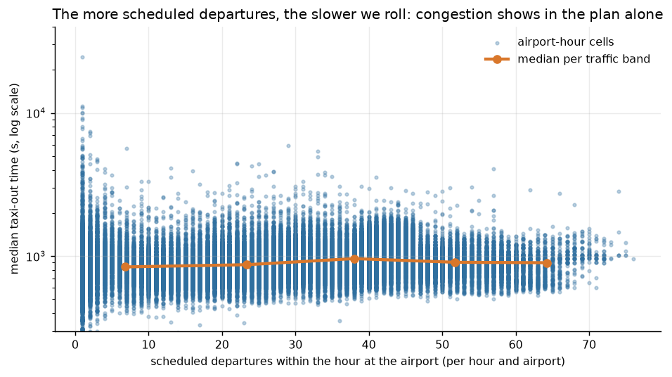
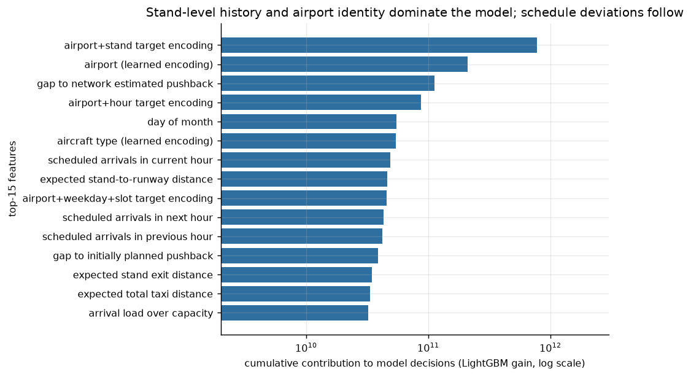

# Feature admissibility — two explicitly separated tracks

Context: the official rules **do not impose any prediction time** and **do not forbid any
column** (see `RULES.md`). The absence of a prohibition does not constitute authorization. The
project therefore maintains two named recipes, never silently mixed, with a repository decision
recorded in `DECISIONS.md`.

## Decisive column: `MVT_TIME_UTC_mvt`

In the finals entries, for departures: `TAXITIME_SEC_mvt` and `BLOCK_TIME_UTC_mvt` are masked
(100% null) by the organizer, but `MVT_TIME_UTC_mvt` (take-off) is present at 0% null and
`AOBT_3_flt` (actual off‑block M3) at 1.4%. Since the target is exactly `MVT_TIME − BLOCK_TIME`,
the organizer therefore provides a near-identity.

- Proxy measured on 2025: `RMSE(MVT_TIME − AOBT_3, cible) = 384,9 s` (MAE 238.1 s), versus
  546–640 s for a constant and 557 s for our best causal model.
- This information would not exist at the moment of pushback: it characterizes a
  **reconstruction**, not a forecast.

## Track A — `causal` (prediction)

Uses what is known at planning/execution time before take-off: schedule, airport, aircraft
type, operator, STAND, flight rule, market segment, planned delays (`EOBT_1`, `IOBT`, `LOBT`),
**planned** network congestion (arrival and departure rates computed on `SCHED_TIME`), plus
encodings learned during training.

Excluded: `MVT_TIME_UTC_mvt`, `AOBT_3_flt`, `BLOCK_TIME_UTC_mvt`, `RUNWAY_mvt` (the runway
actually used), any arrival time, and any aggregation computed including the validation month.

Justification for keeping `EOBT_1/IOBT/LOBT`: these are **planning** fields — they reconstruct
take-off poorly (RMSE 677–740 s versus 384.9 s for `AOBT_3`), which is empirical proof that
they do not leak the target.

*Figure — planned network congestion (arrival/departure rates on `SCHED_TIME`).*

## Track B — `hybrid` (acknowledged reconstruction)

Same base + `proxy_sec = MVT_TIME − AOBT_3`, **actual** rates (observed congestion),
`RUNWAY_mvt`. Two implementations:

1. Analytic (`src/reconstruct.py`): target = proxy corrected for an airport-wise bias, optional
   clipping on the training quantiles, fallback to the causal model when the proxy is unusable
   (null proxy or outside [60 s; 7200 s]: 1.5% of rows, local RMSE ~3,500 s);
2. Model (`configs/tabular_hybrid_model.toml`): the proxy enters as a variable in LightGBM,
   which learns on its own when to distrust it.

## What the measurement shows (development, 4 held-out months)

| recipe | overall RMSE | RMSE excluding outlier targets (> 7200 s) |
| --- | ---: | ---: |
| global mean (low reference) | 640.8 | — |
| A — causal | 557.1 | 382.8 |
| B — analytic reconstruction + clipping | 566.6 | 373.9 |
| airport-weighted linear stacking | 538.3 | — |

Honest reading: on the learnable population, the two tracks are **nearly equivalent**
(382.8 vs 373.9 s, −2.3%), and linear stacking adds only 19 s because both tracks fail on the
**same** implausible rows. The real gain of the proxy is entering as a variable in the model,
not as a competing prediction.

*Figure — feature importance in the frozen causal model.*

## Repository stance

- Track A is the one that responds to the challenge ("predict the taxi time") and to the spirit
  of the rules; it serves as the **default solution** and fallback.
- Track B is produced and documented, labelled "reconstruction", and will only be submitted
  following an explicit and acknowledged decision in `DECISIONS.md` (D‑004), because a ranking
  obtained with the provided take-off time would not have the same meaning.
- Neither track uses anything derived from the ranking process: the official limit of
  5 submissions/day is respected, with no exploratory probing of the hidden targets.
