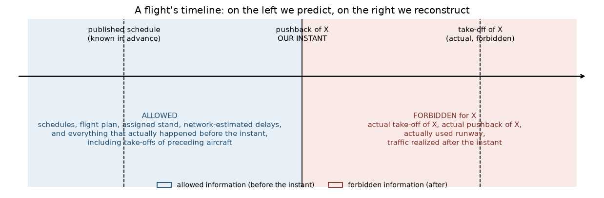

# What Is a Prediction Allowed to Know? (field audit at instant t0)

Audit document, written on 2026‑10‑10 after re-reading the official pages. It answers a
question that the rules do not settle: **at what moment do we position ourselves to predict, and
what do we know at that moment?** The official rules set no prediction instant and forbid no
column (`RULES.md`, section "What the rules do not say"). We therefore take an explicit
position, quantify it, and write down what it costs.

## 1. The chosen instant, and why it is not observable in these files

We call **t0** the moment at which we would imagine a dispatcher-requester seeking to predict
taxiing: just before pushback. What makes the exercise honest here is that **the real t0 is not in
the final-round files**:

| information | present in the 2026 entries? | what this makes it impossible to claim |
| --- | --- | --- |
| `BLOCK_TIME_UTC_mvt` (actual pushback, hence the real t0) | masked at 100 % | we cannot verify that a variable was indeed already known *at that instant* |
| `MVT_TIME_UTC_mvt` (actual takeoff) | **present at 100 %** | its use is not a prediction but a reconstruction (separate track, D‑004) |
| `TAXITIME_SEC_mvt` (the target) | masked at 100 % | — |

Our computation anchor is therefore **the scheduled time** `SCHED_TIME_UTC_mvt`, not the actual
pushback. Stated consequence: everything we call "known in advance" means "recorded in the plan
whose snapshot we were delivered", not "guaranteed available at the second of pushback". This
nuance is the only thing we cannot prove, and that is why it appears at the top of the document
rather than in a footnote.


*Figure — causality timeline around the pushback instant t0.*

## 2. Availability table, variable by variable

Status: **certain** = recorded in the plan before the flight; **ambiguous** = may change between
the snapshot and pushback; **absent from the dataset** = exists in no provided file. Absence rates
are measured over the four 2025 development months **and** on the official 2026 entries (`python`
+ `pandas`, same computation on both sides).

| model variable | provenance | status at t0 | absence 2025 | absence 2026 |
| --- | --- | --- | ---: | ---: |
| hour, day, week, season | `SCHED_TIME_UTC_mvt` | certain (published schedule) | 0,000 % | 0,000 % |
| departure airport | `ADEP_mvt` | certain | 0,000 % | 0,000 % |
| aircraft type (movement) | `AIRCRAFT_TYPE_mvt` | certain | 0,097 % | 0,093 % |
| flight rules (movement) | `FLIGHT_RULE_mvt` | certain | 0,019 % | 0,007 % |
| **park stand** | `STAND_mvt` | **ambiguous** — a stand can be reassigned after the snapshot | 0,002 % | 0,001 % |
| aircraft type (declared by network) | `AIRCRAFT_TYPE_flt` | certain, but 1,34 % of flights without a network record | 1,338 % | 1,353 % |
| wake turbulence category | `WK_TBL_CAT_flt` | same | 1,340 % | 1,357 % |
| market segment | `MARKET_SEGMENT_flt` | same | 1,338 % | 1,353 % |
| flight type (scheduled/charter) | `FLIGHT_TYPE_flt` | same | 1,338 % | 1,353 % |
| flight rules (network) | `FLIGHT_RULE_flt` | same | 1,340 % | 1,357 % |
| operator (anonymized) | `AIRCRAFT_OPERATOR_flt` | same | 1,338 % | 1,353 % |
| schedule deviation — estimated (M1) | `EOBT_1_flt` | certain at planning time, **revised until pushback** | 1,338 % | 1,353 % |
| schedule deviation — initial | `IOBT_flt` | same | 1,338 % | 1,353 % |
| deviation from the last known pushback | `LOBT_flt` | **the latest of the three** — the most exposed to this assumption | 1,338 % | 1,353 % |
| congestion "slots before / now / after" | counts computed over the `SCHED_TIME` of all flights | certain as a *plan*; ignores realized delays | — | — |
| stand→runway offsets, expected distance to runway | learned from the taxi‑in of **arrivals** in the training months | certain (airport geometry) | — | — |
| weather (wind, visibility, snow) | **absent from the dataset** | — | — | — |

Two important readings of this table:

- **the absences are not badly filled columns.** Each `*_flt` column is empty at 1,34 %
  (2025) and 1,35 % (2026) — and these are **the same rows**: on those flights, the eleven network
  columns are missing *all at once*. This is a property of the row (a flight not registered by the
  network), not uneven field quality. In this pocket, 12 of the 34 model variables end up without
  a value; they account for **12,2 %** of the model's decisions (`lightgbm` measure, cumulative
  gain).
- **the `*_mvt` columns are full.** Stand 0,001 %, airport and schedules 0,000 % on the official
  entries: the prediction track does not depend on the network for its primary information.

## 3. What doubt costs, quantified before any decision

Rather than argue about the ambiguity of the stand or of `LOBT`, we measured it in two ways.

**(a) Erasure at inference time** (frozen model replayed, no retraining): resetting the stand to its
"unknown stand" value costs **+8,5 %** of RMSE overall — and the loss is **stronger on ordinary
durations** than on anomalies:

| actual duration | share of rows | frozen | no stand | loss |
| --- | ---: | ---: | ---: | ---: |
| 0–20 min | 76,4 % | 238,1 s | 270,2 s | **+13,5 %** |
| 20–40 min | 22,3 % | 421,5 s | 487,2 s | **+15,6 %** |
| 40–60 min | 1,0 % | 1 387,0 s | 1 526,1 s | +10,0 % |
| > 60 min | 0,3 % | 7 111,4 s | 7 479,0 s | +5,2 % |

In other words: the stand is information about **the belly of the distribution** (it says "a given
stand at Rome taxis in 12 minutes on average, another one in 35"), not tail information.
Neutralizing `LOBT` costs only **+1,0 %**: that field is secondary. *Methodological caveat: erasing
a variable at inference time measures a dependency, not exactly a retraining; the (a) figures are
therefore indicative.*

**(b) Full retrainings** (variants `causal-r10-nostand`, `causal-r11-nolobt`, four held-out folds,
everything else identical — definitive measurement, D‑035):

| variant | January | February | June | July | Jan.+July | global | paired bootstrap |
| --- | ---: | ---: | ---: | ---: | ---: | ---: | --- |
| reference `causal-r2` | 540,0 | 555,4 | 459,0 | 650,2 | 603,5 | **557,1** | — |
| no stand (neither `STAND` nor geometry) | +2,64 % | +1,58 % | +2,20 % | +1,48 % | **+1,90 %** | 567,6 | 95% CI [1,0129 ; 1,0265] → loss established |
| no `LOBT_flt` | +0,10 % | −0,14 % | +0,20 % | +0,01 % | **+0,04 %** | 557,3 | 95% CI [0,9992 ; 1,0016] → indistinguishable |

And the location of the stand loss, on paired rows: **0–20 min (76,4 % of rows) +7,96 %**;
20–40 min +2,27 %; 40–60 min +0,84 %; > 60 min **+0,45 %**. The stand is therefore information
about **the belly of the distribution**, not the tail — the opposite of the intuition tested. `LOBT`, by
contrast, costs nothing to remove: if its status were judged too late, the purified version stands
up without measurable loss.

## 4. What we put down in black and white in the response

1. The **prediction** track uses no information later than pushback *as defined in the official
   dictionary* (`MVT_TIME`, `BLOCK_TIME`, `AOBT_3` excluded, checked by automated tests: setting
   them to `NaN` changes nothing in its variables).
2. It treats `STAND_mvt` as a **planning assignment**, and the three schedule deviations as the
   **latest known version** at the snapshot date. These two assumptions are unverifiable from a
   single snapshot, and the document says so instead of hiding them.
3. If these assumptions were judged too strong, the no-stand variant exists and its cost is
   measured: it is quantified as a percentage of score, not in adjectives.
4. The **reconstruction** track (proxy `décollage − AOBT_3`) is **not** a prediction within the
   meaning of this document: it reads the actual takeoff. It is named, quantified, and left to the
   team's choice (D‑004), never mixed with the previous one.

## 5. Reproducing the figures in this document

```bash
# taux d'absence par colonne, 2025 (mois de dev) et 2026 (entrées officielles) :
PYTHONPATH=. .venv/bin/python scripts/null_rates.py
python -m src.audit                          # audit complet des deux sources d'off-block (reports/AUDIT_SOURCES.md)
python -m src.train --config configs/tabular_causal_nostand.toml --run-id causal-r10-nostand
python -m src.train --config configs/tabular_causal_nolobt.toml  --run-id causal-r11-nolobt
python scripts/check_adoption.py reports/causal-r10-nostand.json reports/causal-r2.json
```
