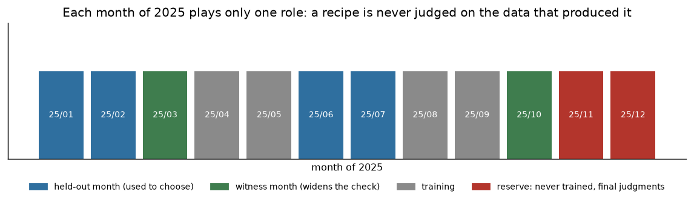

# Validation protocol (fixed before any recipe is frozen)

## Primary metric

The **overall** RMSE across all evaluated rows, matching the official metric. Breakdowns by
month, by airport, MAE, bias (`moyenne(pred − cible)`) and coverage are secondary
and are never used to select a recipe. The unweighted mean of the monthly RMSEs is
explicitly rejected: a test (`tests/test_metrics.py::test_rmse_non_ponderee_par_groupe`) verifies
its divergence.

No row is excluded from the validation score, including physically impossible targets: the
organizer does not remove them, and a silent exclusion would improve the score without improving
the submission. The error distribution is reported separately in order to understand, not to
score.

## Splits (`configs/splits.toml`)

- 12 training months in 2025: January → December.
- **Development folds**: one held-out month among `2025-01`, `2025-02`, `2025-06`, `2025-07`
  — the four months whose distribution must be predicted in the final (January, February, June,
  July 2026). Each fold trains on the other development months.
- **Internal reserve**: `2025-11` + `2025-12`. Never used for training, tuning or recipe
  selection. A **single** opening, after the recipe is frozen and with explicit agreement,
  as a non-reusable estimate of final performance.
- The reserve is later than every fold; no fold includes the reserve (`tests/test_temporal_splits.py`).

*Figure — the temporal split: development folds and the never-touched internal reserve.*

## Anti-leak rules applied in the code

1. Target encodings (airport, operator, aircraft type, STAND), congestion means and geometry
   statistics are fitted **only on the training month** of the fold, then applied as-is to the
   validated month (`tests/test_features_no_leak.py`).
2. Encoding smoothing uses a constant and a prior taken from the training data only.
3. Post-hoc columns are dropped from the frame before fitting *and* causal-track transformation;
   one test sets these columns to NaN and verifies that the variable matrix is unchanged, plus an
   inventory test that rejects any forbidden column.
4. Temporal aggregations (network flow rates) are computed on the window undergoing the
   transformation, never on a mixture of training + validation.
5. When a variant uses **actual** traffic before the anchor (`src.refattente`), the windows are
   strictly earlier than the anchor, future events are excluded, and the evaluated flight is excluded from its
   own counters: `tests/test_observed_traffic.py` checks these three properties.

## Tuning and selection

- Early stopping on a subset **drawn from the training month** (never from the validated month),
  so that the number of iterations is not chosen using the label of the evaluated fold.
- **Adoption rule in force (D‑029)**: RMSE lower by at least **1 % on each of the four target
  months**, computed on 100 % of the rows, **and** a per-row paired bootstrap whose 95 % interval of the
  RMSE ratio excludes 1. Both conditions at once; `scripts/check_adoption.py` applies them
  mechanically. History: the initial 0,5 % threshold was raised to 2 % (D‑026) because with 74 % of the squared error in
  1,34 % of the rows, a few tenths of a percent are noise; completed by the bootstrap on 2026‑10‑10
  (D‑029).
- **Actual scope of the ranking** (home page, re-read on 2026‑10‑10): the official RMSE is computed on
  **January and July 2026**. Any comparison intended for a submission decision is therefore read first on
  **January + July combined** (`scripts/d035_sensitivity.py` provides it), the four months remaining the stability guardrail
  required by the rule above.
- The criterion is unique: no secondary argument (error by category, model elegance) can lead to
  adopting a variant that fails the test above.
- The freeze records: the fingerprint of the official files (SHA‑256), the venv version, the
  configuration hash and the run identifier (`experiments/REGISTRY.md`).

## What remains outside the protocol

- The official final entries (`final_ranking.parquet`) are used **only for inference on departures**:
  no departure target is available in them, and they enter no fold.
- They do, however, contain the **actual arrival taxi times** (670 407 rows). We use them exactly twice, and never for tuning:
  to check the 2025 → 2026 population drift (D‑034) and to measure the local → noted-month factor (D‑036). No variant was chosen based on a
  figure computed on 2026.
- The actual RMSE on the January/February/June/July 2026 departures will only be known through the official ranking;
  the internal reserve is our only uncontaminated estimate (already consumed, D‑030).
- A single measurement submission (reference file, known-in-advance local RMSE) is allowed by the rules
  and documented (`DEPOT.md`); no recipe iteration driven by the displayed scores will be
  (D‑009).
